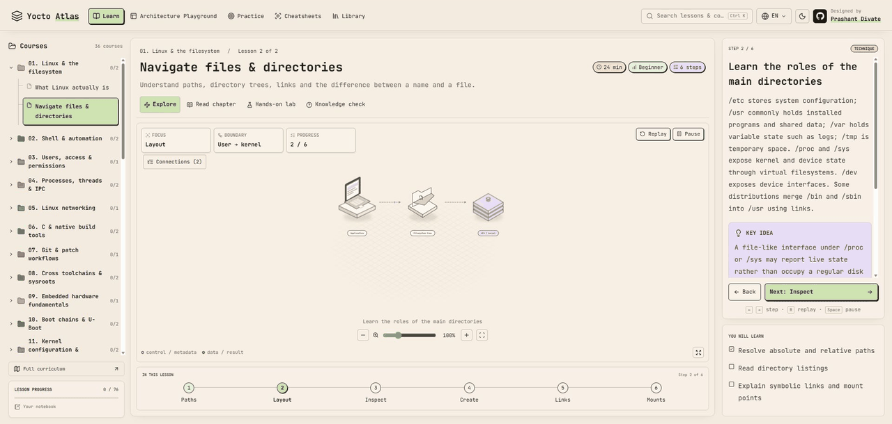

<p align="center">
  <a href="https://prashantdivate.github.io/yocto-atlas/">
    
  </a>
</p>

# Yocto Atlas

An interactive learning platform for Embedded Linux and the Yocto Project, from your first Linux shell to the architecture and maintenance of production devices.

**[Explore Yocto Atlas](https://prashantdivate.github.io/yocto-atlas/)** | **[Report an issue](https://github.com/prashantdivate/yocto-atlas/issues)** | **[Deployment status](https://github.com/prashantdivate/yocto-atlas/actions/workflows/pages.yml)**

## Preview

[](https://prashantdivate.github.io/yocto-atlas/)

The preview cycles through captured lesson views. [Open the interactive website](https://prashantdivate.github.io/yocto-atlas/) to explore diagrams, labs and architecture decisions, or [view the static screenshot](docs/assets/yocto-atlas-preview.png).

## Overview

Yocto Atlas connects concepts, practical observations and product-level decisions in one learning path. It supports developers starting with Linux, engineers learning Yocto, and experienced practitioners reviewing integration and release workflows.

The guided curriculum contains **36 courses, 76 lessons and 392 sections**. Lessons combine explanations, interactive diagrams, command examples, hands-on exercises, expected results, troubleshooting guidance and knowledge checks.

## Features

- **Guided learning:** Progress from Linux fundamentals to board support, Yocto metadata, application integration and production maintenance.
- **Interactive diagrams:** Explore system boundaries and data flows with animation, drag-to-pan, fullscreen and 50-250% zoom. New diagrams default to 200%; saved per-topic preferences take precedence.
- **Hands-on practice:** Complete labs with prerequisites, observations, deliverables and knowledge checks.
- **Architecture Design Playground:** Compare update, storage, trust, recovery and fleet-management decisions, then export a Markdown design brief.
- **Searchable references:** Find lessons, engineering studies and commands through search, the Library and categorized cheatsheets.
- **Security workflows:** Study threat modeling, CVE triage, SBOM validation, remediation and release evidence, including workflows using Yocto Lens and VulnTrack.
- **Release-aware studies:** Explore upstream, community and vendor integrations across different Yocto releases and hardware families.
- **Local progress:** Keep notes, lab completion and quiz results in browser storage, with notebook export.
- **Language options:** Choose from 21 languages for localized navigation, with optional on-device chapter translation in supported browsers.

## Learning Path

| Area | Topics |
| --- | --- |
| Linux foundations | Filesystems, shell scripting, permissions, processes, IPC and networking |
| Development tools | C, Git, patches, cross-compilation, toolchains and sysroots |
| Hardware and platform | Boot chains, U-Boot, kernels, device trees, drivers, buses and interrupts |
| System integration | Root filesystems, initramfs, flash storage, read-only systems and power management |
| Yocto and BitBake | Build configuration, layers, recipes, classes, overrides, tasks, dependencies, packaging and shared state |
| Applications and diagnostics | SDKs, devtool, systemd, Python, Qt, containers, Rust, debugging, tracing and real-time behavior |
| Production engineering | Cybersecurity, licenses, SBOMs, OTA updates, rollback, fleet operations, CI and release evidence |

## Quick Start

### Requirements

- Node.js 24 and npm, matching the version used by CI.
- A modern browser. On-device translation requires additional browser and language-pair support.

Linux, a Yocto build environment and target hardware are **not required to run the website**. Individual labs describe their own requirements.

### Run Locally

```bash
git clone https://github.com/prashantdivate/yocto-atlas.git
cd yocto-atlas
npm ci
npm run dev
```

Open [http://localhost:5173](http://localhost:5173). The development server binds to loopback only.

On Windows PowerShell, use `npm.cmd` instead of `npm` if script execution policy blocks the npm PowerShell wrapper. To choose another port:

```powershell
$env:PORT = '5174'
npm.cmd run dev
```

### Commands

| Command | Purpose |
| --- | --- |
| `npm ci` | Install dependencies from the lockfile |
| `npm run dev` | Start the local development server |
| `npm test` | Run curriculum, route, design-model, diagram-layout and publication checks |
| `npm run build` | Generate the public static website in `dist/` |

## GitHub Pages Deployment

The site is published through [GitHub Actions](.github/workflows/pages.yml). Pushes to `main` run the tests, generate the public build and deploy `dist/` to GitHub Pages. The workflow can also be started manually from the Actions tab.

For a new repository, select **Settings > Pages > Build and deployment > Source > GitHub Actions** before running the workflow.

The public build uses relative asset paths and hash-based navigation, allowing it to run under a repository subpath such as `/yocto-atlas/`. It requires no application server or database.

## Public Content and Local References

The public website includes the authored curriculum, diagrams, labs, cheatsheets and source-linked engineering studies. It does **not** distribute licensed PDF books or extracted textbook chapters.

An optional local reference library supports 12 supplied PDFs and 136 indexed technical chapters. These files are not included in the repository. A fresh clone runs without them; local-book controls are hidden when the catalog is unavailable.

| Local-only directory | Contents |
| --- | --- |
| `Resources/` | Privately supplied reference PDFs |
| `textbooks/` | Extracted chapters, catalog and search index |
| `.research/` | Local research and extraction output |

These directories are excluded from version control and the public build. Extraction utilities require Python and `pypdf`. Use them only with reference material you are authorized to process. Publishing or redistributing reference material requires separate permission; adding files to the local library does not include them in the public site.

## Browser Storage and Languages

Notes, progress, design choices and zoom preferences are stored in the current browser and origin. They do not synchronize between devices. Clearing browser storage removes them; export notebook entries before clearing data you want to retain.

The language picker provides 21 navigation languages. Where supported, chapter prose can be translated using the browser's on-device Translator API; language models may need downloading. Unsupported browsers retain English prose and display a status message.

Translation is machine-generated, not human-reviewed technical localization. Commands, code, diagram labels and original PDF pages remain unchanged. This implementation does not send course prose to a cloud translation service.

## Project Structure

```text
.github/workflows/pages.yml   GitHub Pages build and deployment
index.html                   Application entry point
server.mjs                   Loopback development server
src/
  course-app.js              Navigation, views, assessments and persistence
  course-catalog.js          Course organization and learning outcomes
  course.js                  Curriculum assembly and routing
  scenes.js                  Animated diagrams, zoom and panning
  design-model.js            Architecture checks and planning estimates
  design-lab.js              Architecture Design Playground interface
  cheatsheet.js              Searchable command reference
  engineering-guides.js      Source-linked technical studies
  cybersecurity.js           Security lessons and tool workflows
  languages.js              Navigation localization and translation
  textbook-reader.js        Optional local reference reader
scripts/
  build.mjs                 Public static-build allowlist
  build_textbooks.py         Local PDF chapter extraction
  index_resources.py        Local reference indexing
  rename-resources.mjs      Descriptive reference-file renaming
*.test.js                   Automated checks
DESIGN.md                   Design rationale and implementation notes
```

## Contributing

Bug reports, technical corrections and focused lab contributions are welcome.

1. Open an issue describing the problem or proposed topic.
2. Include the relevant lesson, Yocto release, hardware context and supporting primary documentation.
3. Keep changes focused and preserve release-specific assumptions and source attribution.
4. Run `npm test` and `npm run build` before submitting a pull request.
5. Check user-interface changes on desktop and mobile layouts.

Do not include credentials, private build reports, machine-specific user paths or reference material without redistribution permission in issues or pull requests.

## Scope and Limitations

- Commands are educational examples. The website does not execute shell commands, run BitBake, scan devices or deploy firmware.
- Labs require an appropriate development environment. Review commands and recovery procedures before using real hardware.
- Release and hardware selections provide context; they do not rewrite examples or establish a vendor support matrix.
- Architecture outputs are qualitative guidance and limited capacity estimates, not validated flash layouts, benchmarks or compatibility certifications.
- An SBOM, scanner result or successful quiz is not proof of product security or compliance. Product-specific review and target testing remain necessary.
- Automated website checks do not replace actual Yocto builds, hardware validation or security assessments. PDF integrity checks are skipped when the optional local references are absent.

## Acknowledgments and Licensing

The visual direction is inspired by [Designed to Scale](https://designed-to-scale.vercel.app/). Engineering studies link to their upstream, community and vendor sources, including the Yocto Project documentation and relevant project repositories.

Icons use Lucide and the Simple Icons GitHub mark; typography uses JetBrains Mono. Third-party license notices are retained with the assets included in the public build. Referenced projects, trademarks and publications remain the property of their respective owners.

This repository does not currently declare a project-level license. Third-party source links and bundled dependency licenses do not establish a license for the repository's original code or learning content.
